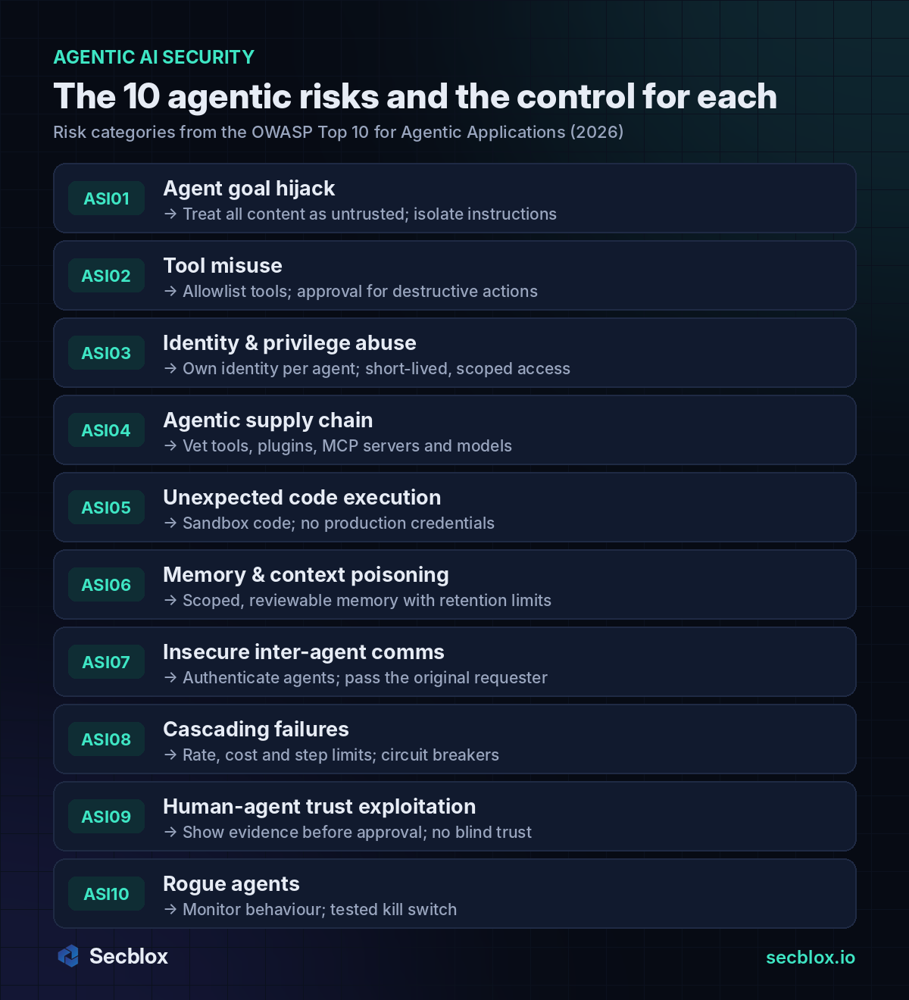

**Agentic AI security is the practice of protecting AI systems that can plan, use tools, keep memory and take actions with little human oversight — and protecting everything those agents can reach.** The risk is no longer just a model saying the wrong thing; it's an agent doing the wrong thing with real permissions. The OWASP Top 10 for Agentic Applications (2026) gives the clearest map of those risks, and most of them are reduced by a small set of controls applied consistently.

## What is agentic AI security?

A chatbot answers a question. An agent pursues a goal: it breaks the task into steps, calls tools and APIs, reads documents and web pages, remembers context between sessions and sometimes hands work to other agents. Each of those abilities is useful, and each one is a new way for something to go wrong.

That changes where security has to focus. With a plain large language model (LLM) feature, the main risks are data leakage, harmful output and prompt injection. With an agent, the same injection can turn into an action: a deleted record, an email sent to the wrong person, a payment, or data copied somewhere it shouldn't be. Agentic AI security therefore covers the agent's identity and permissions, its tools, its memory, its communication with other agents and the humans who approve its work — not just the model.

## What is the OWASP Top 10 for Agentic Applications?

The OWASP GenAI Security Project published the Top 10 for Agentic Applications on 9 December 2025, as the 2026 edition. It sits alongside the better-known OWASP Top 10 for LLM Applications, which focuses on the model layer; the agentic list focuses on what happens when AI systems act. The risks are numbered ASI01 to ASI10.

{width=1200 height=1320}
*The ten agentic risk categories and the control we start with for each.*

## The 10 agentic AI risks, in plain English

| Code | Risk | What it looks like | First control |
|---|---|---|---|
| ASI01 | Agent goal hijack | Hidden instructions in an email, document or web page redirect what the agent is trying to do | Treat all external content as untrusted data, never as instructions |
| ASI02 | Tool misuse and exploitation | The agent uses a tool it's allowed to use, in a way nobody intended — deleting instead of reading | Tool allowlists, narrow tools and approval for destructive actions |
| ASI03 | Identity and privilege abuse | The agent inherits, reuses or leaks credentials and acts beyond its intended scope | A separate identity per agent with short-lived, task-scoped access |
| ASI04 | Agentic supply chain | A compromised tool, plugin, prompt template, model or MCP server changes the agent's behaviour | Vet and pin every component; review new integrations like any vendor |
| ASI05 | Unexpected code execution | The agent writes or runs code that does more than intended | Sandboxed execution with no production credentials |
| ASI06 | Memory and context poisoning | A malicious entry saved to memory influences later sessions or other users | Scoped, reviewable memory with retention limits |
| ASI07 | Insecure inter-agent communication | Agents trust messages from other agents without verifying who sent them | Authenticate agents and pass the original requester's identity along |
| ASI08 | Cascading failures | One bad step spreads through a chain of agents and tools | Rate, cost and step limits; circuit breakers between stages |
| ASI09 | Human-agent trust exploitation | People approve what the agent proposes without checking it | Show evidence and reasoning before approval; train reviewers |
| ASI10 | Rogue agents | An agent behaves outside its intended purpose and keeps going | Behaviour monitoring and a tested kill switch |

The categories chain together. A typical incident starts with goal hijack (ASI01), turns into tool misuse (ASI02) because the agent has broad permissions (ASI03), spreads (ASI08) and is waved through by a reviewer who trusted the output (ASI09). Breaking the chain early — at identity and tool permissions — prevents most of the damage.

## Which controls reduce most of the risk?

You don't need ten separate programmes. Six controls cover most of the list:

1. **A scoped identity for every agent.** No shared service accounts and no borrowed human sessions with full rights. Each agent gets its own identity, linked to the user or service it acts for. (ASI03, ASI07, ASI10)
2. **Least privilege and an allowlist of tools.** Narrow tools ("look up this customer's plan") rather than general ones ("run any query"), read separated from write, short-lived credentials. (ASI02, ASI03)
3. **Human approval for high-impact actions.** Payments, deletions, external messages and production changes wait for a person — who sees the evidence, not just a summary. (ASI02, ASI09)
4. **Isolation.** Sandboxes for code, separate environments for development and production, and outbound network limits. (ASI05, ASI08)
5. **Governed memory and supply chain.** Memory scoped per user or tenant with retention rules; tools, plugins and models vetted and version-pinned. (ASI04, ASI06)
6. **Full logging and a kill switch.** Prompts, decisions, tool calls and data access are logged against the agent identity; credentials can be revoked and execution stopped in minutes. (ASI01, ASI10)

These are the same principles we cover in [zero trust for AI agents](/blog/zero-trust-for-ai-agents/), applied to the specific risks OWASP lists.

## How do you test agentic AI before go-live?

Each control is an assumption until it has been tested under attack. Least privilege on paper and least privilege when someone is actively trying to misuse the agent are not the same thing. A pre-launch test should try to:

- **Hijack the goal through every input the agent reads** — not just the chat box, but documents, web pages, emails, tickets and tool outputs (indirect prompt injection).
- **Misuse legitimate permissions** — can the agent be steered into deleting, exporting or sending data using access it's allowed to have?
- **Poison memory** — does one malicious entry change what the agent does in later sessions or for other users?
- **Break the tool boundary** — what happens when a connected system returns hostile content?
- **Trigger the kill switch** — does revoking the agent's access actually stop it, and how long does that take?

Re-test after every new tool, permission, memory feature or model change. Agents drift faster than normal applications, so a single test at launch goes stale quickly. Our guide to [prompt injection controls for SOC 2](/blog/prompt-injection-controls-soc-2/) covers the input side in more depth.

## How does agentic AI security map to SOC 2, ISO 42001 and NIST?

Agent controls aren't extra work on top of compliance; they're how existing frameworks apply to agents.

- **SOC 2** — agent identities and access reviews (CC6), monitoring of agent activity and incident response (CC7), and change control for prompts, tools and models (CC8). See [SOC 2 for AI companies](/soc-2-for-ai-companies/).
- **ISO/IEC 42001** — AI risk and impact assessments, defined roles and operational controls for AI systems.
- **NIST AI RMF** — the Govern, Map, Measure and Manage functions give a structure for agent risk decisions; MITRE ATLAS adds a catalogue of real attack techniques for threat modelling.
- **EU AI Act** — human oversight, logging and transparency duties apply to many agent use cases.

For the governance layer, see [AI governance for SaaS startups](/blog/ai-governance-for-saas-startups/).

## In practice

The agent deployments we review usually fail on the same two points before anything exotic: agents running under one broad service account or a developer's own credentials, and tool lists that grew during a proof of concept and were never cut back. Fixing those — a scoped identity per agent, the tool list reduced to what the task needs, and every tool call logged — removes the path most of the OWASP scenarios rely on. It's a design decision that is far cheaper before agents reach production than after the first incident.

## FAQ

### What is the difference between AI security and agentic AI security?

AI security covers the whole AI stack: data, models, prompts and the applications around them. Agentic AI security is the part that deals with autonomy — agents that call tools, keep memory, work with other agents and take actions. The extra risks come from permissions and actions, not just from model output.

### Is the OWASP Top 10 for Agentic Applications a standard I must comply with?

No. It's community guidance, not a regulation or certification. But it's a practical reference for agent threat modelling, and a clear way to show customers and auditors that you've considered agent-specific risks.

### Does the OWASP Top 10 for LLM Applications still apply to agents?

Yes. Agents are built on LLMs, so prompt injection, sensitive information disclosure and excessive agency from the LLM list still apply. The agentic list adds the risks that appear once the model can act, remember and coordinate.

### How often should AI agents be security tested?

Before go-live, and again whenever you add a tool, widen a permission, add memory or change the underlying model. A practical rhythm is a short automated test on every release and a full manual test at least once a year.

Related: [AI security assessment: scope and process](/blog/ai-security-assessment/) and [zero trust for AI agents](/blog/zero-trust-for-ai-agents/). See our [penetration testing service](/services/penetration-testing/), including LLM and agent testing, or [book a free scoping call](/contact/).
