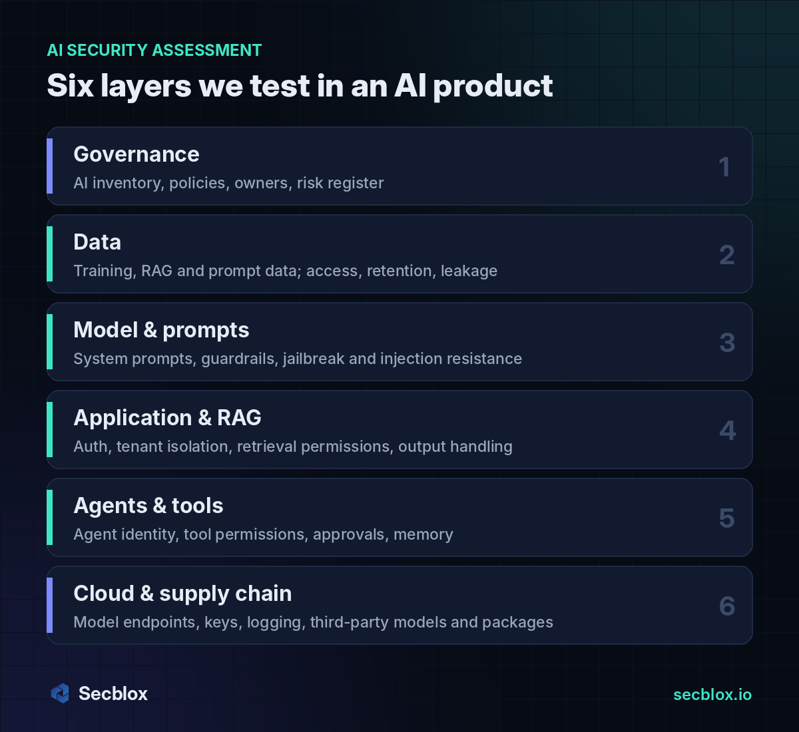

**An AI security assessment is a structured review and hands-on test of an AI product — its governance, data, model and prompts, application and retrieval layer, agents and tools, and the cloud and supply chain underneath — ending in a prioritised list of fixes.** It answers the question enterprise customers ask when they review an AI vendor: what stops your AI feature from leaking our data or doing something it shouldn't? For most SaaS and AI companies, the answer comes from testing six layers, not just the model.

## What is an AI security assessment?

A traditional application security assessment looks at authentication, authorisation, input handling and infrastructure. An AI security assessment covers all of that and adds the parts that are specific to AI: prompts that can be manipulated, retrieval systems that can surface the wrong customer's data, models and datasets from third parties, and agents that can take actions.

It sits between two neighbouring activities. A **penetration test** focuses on exploiting weaknesses; an **AI risk assessment** focuses on governance and business impact. A good AI security assessment does both: it maps the risks, then proves which ones are real by testing them. If you only need the governance side, our [AI risk assessment template](/blog/ai-risk-assessment-template/) is a good starting point.

## What does an AI security assessment cover?

{width=1200 height=1100}
*The six layers of an AI product we review and test.*

| Layer | What we review | Typical findings |
|---|---|---|
| 1. Governance | AI inventory, acceptable use policy, owners, risk register, vendor list | AI features nobody inventoried; no owner for model changes |
| 2. Data | Training data, retrieval (RAG) sources, prompt and output logs, retention | Customer data in prompt logs kept indefinitely; no deletion path |
| 3. Model and prompts | System prompts, guardrails, jailbreak and prompt injection resistance | System prompt extractable; guardrails bypassed by indirect injection |
| 4. Application and RAG | Authentication, tenant isolation, retrieval permissions, output handling | Retrieval returns documents the user can't normally see; unsafe rendering of model output |
| 5. Agents and tools | Agent identity, tool permissions, human approvals, memory | Agent runs under a broad service account; destructive tools without approval |
| 6. Cloud and supply chain | Model endpoints, API keys, logging, third-party models and packages | Model API keys in code; no logging of model calls; unpinned model versions |

The most serious findings rarely need exotic attacks. In multi-tenant products, one of the most damaging issues is retrieval that ignores the user's own permissions — the model then summarises another customer's document perfectly politely.

## How does the assessment work?

1. **Scope.** Agree which AI features, models, data sources, agents and environments are in scope, and the frameworks to map against.
2. **Architecture and data-flow review.** Trace how a request moves through the product: user, application, retrieval, model, tools and back. Most risks are visible on this diagram before any testing starts.
3. **Threat modelling.** Map likely attacks using MITRE ATLAS, the OWASP Top 10 for LLM Applications and the OWASP Top 10 for Agentic Applications. This keeps testing focused on what matters for your design.
4. **Hands-on testing.** Direct and indirect prompt injection, attempts to extract system prompts and sensitive data, cross-tenant retrieval tests, tool and permission abuse, memory poisoning where memory exists, and standard web and API testing around the AI feature.
5. **Configuration review.** Model endpoints, key management, logging, rate limits and third-party model and package versions in your cloud environment.
6. **Report and walkthrough.** Findings ranked by real-world risk, with evidence, remediation steps and an owner for each.
7. **Re-test.** Confirm that critical and high findings are fixed, with a letter you can share with customers and auditors.

For agent-heavy products, see our breakdown of the [OWASP Top 10 for agentic AI security](/blog/agentic-ai-security/).

## What should the deliverables include?

- **A findings report** ranked by risk, with reproduction steps and evidence.
- **A remediation plan** that engineers can act on, ordered by risk and effort.
- **A threat model** of your AI architecture you can keep updating.
- **A control mapping** to SOC 2, ISO/IEC 42001, the NIST AI RMF and, where relevant, the EU AI Act.
- **A re-test letter** for customers, auditors and security questionnaires.

## How does it map to SOC 2, ISO 42001 and the EU AI Act?

- **SOC 2** doesn't have AI-specific criteria, but AI features fall under the same controls as the rest of your system: logical access (CC6), monitoring (CC7), change management for prompts and models (CC8) and vendor risk for model providers (CC9). See [does SOC 2 cover AI and LLM vendors](/blog/does-soc-2-cover-ai-llm-vendors/).
- **ISO/IEC 42001** expects AI risk and impact assessments and operational controls; the assessment supplies the evidence.
- **NIST AI RMF** — findings map naturally to the Measure and Manage functions; NIST AI 600-1 adds generative AI risks.
- **EU AI Act** — logging, robustness, cybersecurity and human oversight duties apply to many AI systems; testing shows how you meet them.

## How often should you run one?

Run a full assessment before launching a significant AI feature, then at least once a year. Re-test the affected layer whenever you change model provider, add a data source to retrieval, give an agent a new tool or permission, or add memory. Small changes to prompts and tools can reopen issues you already fixed, so build a short set of prompt injection and permission tests into your release process too.

## In practice

Most AI security assessments we run find fewer model problems than teams expect and more ordinary ones. The common pattern is a well-guarded chat interface sitting on top of retrieval that doesn't check the user's permissions, an agent with more tool access than its job needs, and model calls that aren't logged anywhere an incident responder could find them. Fixing retrieval permissions and logging usually closes the highest-risk findings within a sprint, and the same evidence then answers the AI section of customer security questionnaires.

## FAQ

### What is the difference between an AI security assessment and AI red teaming?

AI red teaming is adversarial testing — trying to make the system misbehave. An AI security assessment includes that testing but also reviews architecture, data flows, configuration and governance, and maps findings to frameworks. Red teaming is one part of a full assessment.

### How long does an AI security assessment take?

For a single AI feature in a SaaS product, typically one to three weeks including the report, depending on how many models, data sources and agents are in scope. Re-testing usually takes a few days.

### Do we need an AI security assessment if we use a third-party model API?

Yes. Most risks sit in your own layers — retrieval, permissions, tools, prompts, logging and data handling — not inside the provider's model. You also need to review the provider's data use, retention and security commitments as part of vendor risk.

### Will an AI security assessment help with enterprise security reviews?

Yes. When a security questionnaire includes AI questions, a recent assessment with a re-test letter and control mapping lets you answer them with evidence rather than promises. See our [AI vendor risk assessment questions](/blog/ai-vendor-risk-assessment-questions/) for what buyers ask.

Related: [agentic AI security and the OWASP Top 10](/blog/agentic-ai-security/) and [prompt injection controls for SOC 2](/blog/prompt-injection-controls-soc-2/). See our [penetration testing service](/services/penetration-testing/) and [AI governance services](/ai-governance/), or [book a free scoping call](/contact/).
